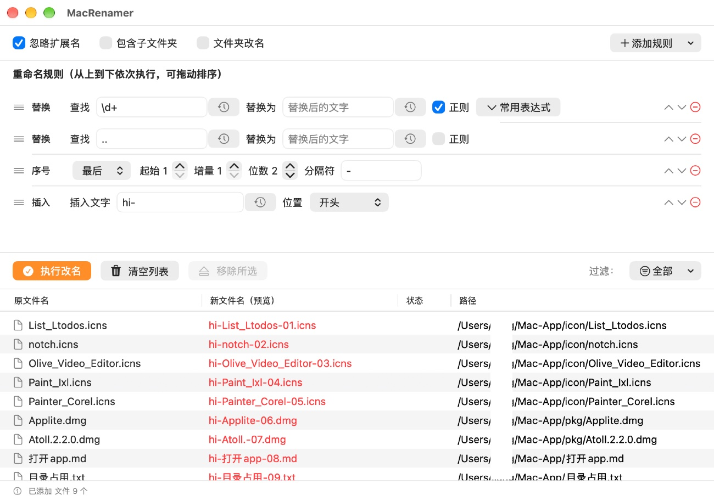

# MacRename — 批量重命名小工具（macOS 15+）

一款用 Swift + SwiftUI 写的 macOS 重命名小工具，可直接用 Xcode 编译运行。
界面参考了win平台的miniRenamer



## 如何运行
没有经过签名，如果提示异常。
去“系统设置 -> 隐私与安全性”里手动点击“仍要打开”，
甚至需要运行命令 `xattr -dr com.apple.quarantine ` 来绕过限制。‌

## 使用说明

- **拖入文件/文件夹**：直接把文件或文件夹拖进窗口；也可以用顶部菜单 `文件 → 选择文件…`（可多选）或 `文件 → 选择文件夹…`。
- **预览**：所有改名操作只会先在下方显示“预计结果”（红色），只有点「执行改名」才真正改文件。
- **顶部选项**：
  - 忽略扩展名（默认勾选）：规则不会改到扩展名。
  - 包含子文件夹：选择/拖入文件夹时递归遍历子文件夹。
  - 文件夹改名：列表里也显示文件夹本身。
- **规则**：点右上角「添加规则」添加；支持「转换 / 随机 / 插入 / 替换 / 删除 / 序号」六种，可拖动排序、按从上到下顺序依次执行。
- **过滤**：操作栏右侧的“过滤”按已拖入文件的后缀筛选列表。
- **状态栏**：底部会显示当前已添加的文件/文件夹数量。

## 如何编译运行

1. 用 Xcode 打开 `MacRenamer.xcodeproj`。
2. 选择顶部的运行目标 `MacRenamer`（选择“My Mac”）。
3. 按 `⌘R` 运行。

> 说明：工程没有开启沙盒（App Sandbox），所以可以直接读写任意文件。
> 签名使用“Sign to Run Locally”（本地 ad-hoc 签名），无需开发者账号。
> 
## 打包（通用二进制，同时支持 Intel 和 Apple Silicon）

工程已配置为 Release 打包时生成“通用二进制（universal binary）”，同时包含 `arm64`（Apple Silicon）和 `x86_64`（Intel）两种架构，一个 App 即可在两种 Mac 上运行。

在 Xcode 里打包：
1. 顶部运行目标选择「Any Mac」。
2. 菜单 `Product → Archive` 归档，然后 `Distribute App` 导出。

也可以用命令行打包：

```shell
xcodebuild -project MacRenamer.xcodeproj -scheme MacRenamer \
  -configuration Release -destination 'generic/platform=macOS' build
```

- **Release**：`ARCHS = arm64 x86_64`、`ONLY_ACTIVE_ARCH = NO`，打包出双架构。
- **Debug**：只编译当前机器架构，加快日常调试。
- 只想打某一种架构时，命令行追加 `ARCHS=arm64` 或 `ARCHS=x86_64` 即可。

## 代码结构

| 文件 | 作用 |
| --- | --- |
| `MacRenameApp.swift` | 程序入口、窗口、菜单栏 |
| `ContentView.swift` | 主界面布局 |
| `AppSettings.swift` | 全局状态 + 选文件/拖入/预览/改名等逻辑 |
| `RenameRule.swift` | 规则模型和各种下拉选项 |
| `RenameItem.swift` | 单个待改名条目 |
| `RenameEngine.swift` | 纯计算：根据规则算出新名字 |
| `RuleRowView.swift` | 单条规则的编辑行 |
| `HistoryTextField.swift` | 带历史记录下拉的文本框 |

代码里写了很多中文注释，方便新手阅读。
